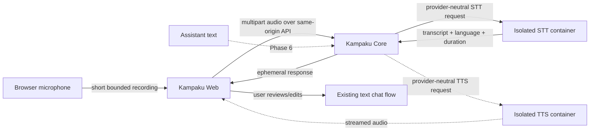

# Voice foundation plan — speech-to-text first

## Decision summary

- **Priority:** deliver speech-to-text (STT) before text-to-speech (TTS). The first useful slice lets the emperor record a short message, inspect/edit the transcript, and then send it through the existing text chat path.
- **Deployment:** inference runs in replaceable Docker services. Kampaku owns provider-neutral adapters and never imports model-specific runtime code into the Node processes.
- **Privacy default:** local inference, no external provider fallback, no persisted raw audio, no telemetry, and no host-wide port exposure.
- **Security scope:** preventative controls and security acceptance criteria begin in Phase 1. Vulnerability assessment, penetration testing, adversarial model testing, and ethical hacking are not part of this plan and require a later, explicitly scoped process.
- **Implementation is not authorized yet:** this document is the review gate. No image pull, service launch, branch switch, or source edit should occur until the plan is accepted.

## Confirmed repository constraints

The workspace root (`/home/pdonoso/kampaku`) is an orchestration directory, not a Git repository. `kampaku-core`, `kampaku-web`, `kampaku-worker`, `kampaku-contracts`, and `kampaku-docs` are independent repositories. The root `docker-compose.yml` and `.cursor/plans` therefore cannot be delivered or reviewed on a feature branch today.

Several repositories also contain pre-existing local changes. They must not be silently included in, moved by, or committed to this feature.

### Branch and ownership strategy

Before implementation:

1. Record the starting branch, commit, and dirty paths in every affected repository.
2. Do not stash, discard, or carry unrelated local edits without explicit approval.
3. Create isolated worktrees where needed, using a coordinated branch name such as `feature/voice-stt-foundation` in each affected repository.
4. Put versioned container deployment assets under `kampaku-core/deploy/voice/` initially, because core owns the API/provider boundary. Do not modify the untracked root compose file as the sole implementation artifact.
5. Use `kampaku-docs` for the architecture decision and operator guide, and `kampaku-web` for capture/playback UI. Keep `kampaku-worker` and `kampaku-contracts` out of the first slice unless contract discovery proves they are required.

If the team later creates a dedicated infrastructure repository, the compose assets can move there in a separate change.

## Target architecture

The browser never talks directly to an inference container. Core enforces authentication, request limits, timeouts, content validation, concurrency, and normalized errors. A transcript is not sent automatically: the user can review or edit it in the existing composer first.

## Provider candidates and selection gate

Candidate images are inputs to a controlled spike, not selections to hard-code now.

### STT — evaluate first

1. **Primary candidate: a maintained faster-whisper OpenAI-compatible server.** This minimizes adapter complexity and supports CPU/CUDA variants. Community server images must pass provenance, release cadence, license, SBOM/signature, architecture, and non-root execution checks before adoption.
2. **Fallback candidate: `ghcr.io/ggml-org/whisper.cpp`.** It is the upstream project image and supports amd64/arm64, but its server contract must be verified against Kampaku's required multipart transcription behavior.
3. **No `latest` in committed configuration.** After the spike, pin an immutable version and preferably an image digest. Model identifiers and model checksums must also be pinned.

### TTS — evaluate only after the STT gate

1. **Primary candidate: `ghcr.io/remsky/kokoro-fastapi-cpu` or its hardware-specific sibling.** It exposes an OpenAI-compatible speech endpoint and has CPU/CUDA variants.
2. **Fallback candidate: Piper-based service** if lower resource use, deterministic offline behavior, or language/voice licensing makes it preferable.
3. Validate Spanish quality as product behavior while keeping all persisted repository artifacts and UI copy in English, per workspace policy.

### Spike scorecard

Select with reproducible measurements on the actual host:

- cold start and warm request latency;
- real-time factor and peak RAM/VRAM;
- Spanish and English transcription quality using a small consented fixture set;
- punctuation, numerals, proper nouns, silence, background noise, and code-switching;
- supported audio formats and resampling behavior;
- image size, supported architecture, license, provenance, update cadence, and known vulnerability surface;
- offline startup after models are cached;
- health/readiness behavior and clean failure when the model is unavailable.

The spike output is a short English decision record in `kampaku-docs/adr/`. Raw personal recordings must not be committed as fixtures.

## Phase 0 — baseline and isolated branches

**Goal:** ensure the work is reviewable and cannot absorb unrelated local changes.

Actions:

- Identify the exact commits from which `kampaku-core`, `kampaku-web`, and `kampaku-docs` should branch.
- Create separate worktrees/branches only after resolving their existing dirty state with the emperor.
- Confirm that tracked deploy assets live under `kampaku-core/deploy/voice/`.
- Capture hardware facts without secrets: CPU architecture, available RAM, Docker version, and optional GPU/runtime support.

Pass criteria:

- each implementation diff contains only voice-related changes;
- no user-owned uncommitted file is stashed, overwritten, or committed;
- the compose definition and operator instructions are tracked in a Git repository.

## Phase 1 — contracts and security baseline

**Goal:** make the application independent of a specific model server and establish safe defaults before inference is connected.

Define in core:

- `SpeechToTextProvider.transcribe(input, options)` returning text, detected language, duration, and optional segments;
- `TextToSpeechProvider.synthesize(text, options)` as a deferred-compatible boundary, without exposing TTS in the UI yet;
- configuration for internal base URLs, selected models, timeouts, size/duration limits, supported MIME types, concurrency, and feature flags;
- stable error categories: invalid media, too large/long, unavailable, timeout, unsupported language/format, and transcription failure;
- liveness versus model-readiness checks.

Security baseline:

- bind inference ports to an internal Docker network, or to loopback only for explicit diagnostics;
- no default outbound network after image/model provisioning; document any unavoidable startup download;
- read-only root filesystem where compatible, dropped Linux capabilities, `no-new-privileges`, non-root user, bounded CPU/memory, temporary filesystem, and no Docker socket mount;
- no API keys, transcripts, audio bytes, or signed URLs in logs;
- validate declared MIME type and decoded media characteristics; never trust filename extensions;
- enforce request byte, duration, sample-rate/channel, timeout, concurrency, and text-output limits before expensive inference;
- delete temporary audio on success, error, timeout, and cancellation; prefer memory/stream processing where practical;
- same-origin/authenticated core endpoint with explicit CSRF posture and rate limiting;
- generic client errors with structured internal diagnostics that contain no audio content;
- dependency/image scanning may run as normal supply-chain hygiene, but it is not presented as a formal security assessment.

Deliverables:

- ADR describing trust boundaries and provider choice criteria;
- API schema and representative examples;
- unit tests for limits, normalized errors, redaction, and cleanup behavior.

## Phase 2 — container spike and selection

**Goal:** prove one STT image on the target hardware without wiring it into production paths.

Actions after plan approval:

1. Pull exact candidate tags, record resolved digests, inspect manifests/configuration, and scan them with the available local scanner.
2. Start one candidate at a time using the restrictive compose profile.
3. Cache model weights in a dedicated named volume with documented provenance and checksum where available.
4. Run the scorecard fixtures and record results.
5. Select and pin one STT image. Do not keep unused images/services in the default profile.

Pass criteria:

- selected image works offline after provisioning;
- no inference port is reachable from the LAN by default;
- resource use fits an agreed host budget;
- transcription meets the agreed Spanish/English fixture threshold;
- the exact image digest, model, model checksum/provenance, license, and removal/upgrade steps are documented.

## Phase 3 — core STT endpoint

**Goal:** provide one bounded internal application endpoint for transcription.

Proposed contract:

- `POST /api/v1/audio/transcriptions` using one multipart audio part plus optional language hint;
- response includes transcript text and non-sensitive metadata only;
- no database persistence of raw audio or transcript by the transcription endpoint;
- transcript enters conversation history only if the user later sends it through the existing chat API.

Implementation work:

- provider adapter using the existing HTTP/OpenAI-compatible conventions where possible;
- streaming or bounded temporary-file handling with guaranteed cleanup;
- abort propagation when the browser cancels;
- readiness surfaced through the existing health/status model without leaking internal topology;
- disabled-by-default feature flag if the inference service is absent.

Tests:

- provider contract tests with a fake server;
- endpoint tests for authentication, MIME/content mismatch, limits, timeouts, cancellation, malformed provider output, redacted logs, and cleanup;
- health tests distinguishing core availability from voice-model readiness.

## Phase 4 — web STT experience

**Goal:** make dictation useful without changing the semantics of chat submission.

User flow:

1. User explicitly presses a microphone control.
2. Browser requests microphone permission only at that moment.
3. UI shows recording state, elapsed time, and a clear stop/cancel action.
4. Recording stops automatically at the configured duration limit.
5. Audio is uploaded for transcription; the returned text populates the composer.
6. User reviews/edits the transcript and presses the existing Send action.

Requirements:

- no background listening, auto-start, or auto-send;
- clear permission-denied, unsupported-browser, timeout, and service-unavailable states;
- keyboard and screen-reader accessible controls with English persisted UI copy;
- release microphone tracks and object URLs on stop, cancel, navigation, and component unmount;
- prevent duplicate uploads/submissions and allow retry without losing typed text;
- select a browser recording format through capability detection, not user-agent detection.

Tests:

- component tests for all state transitions and cleanup;
- API-mocking tests for success, cancel, timeout, and retry;
- Playwright happy path with synthetic media, plus permission-denied and service-down cases.

## Phase 5 — STT release gate

STT is ready for opt-in use only when:

- unit, integration, build, and end-to-end checks pass in core and web;
- the selected container starts from pinned artifacts and passes readiness checks;
- all audio cleanup and logging-redaction tests pass;
- LAN exposure and outbound behavior match the documented default;
- Spanish and English fixtures meet the accepted quality/latency budget;
- disabling voice restores the current chat experience with no regression;
- operator docs cover enable, disable, update, rollback, model cache removal, and full data cleanup.

Pause for emperor acceptance here before TTS implementation.

## Phase 6 — TTS follow-up

**Goal:** add optional playback without coupling chat generation to audio generation.

- Add `POST /api/v1/audio/speech` behind the existing provider boundary.
- Generate speech only after assistant text exists; a TTS failure must never fail or alter the text response.
- Start with an explicit per-message Play action. Autoplay remains off by default.
- Stream audio where supported, provide stop/replay, and cancel generation on navigation.
- Do not persist generated audio by default; use bounded browser memory/object URLs and revoke them reliably.
- Pin voice/model choice and document voice/model licensing.
- Apply text length, concurrency, timeout, rate, and resource limits equivalent to STT controls.
- Add contract, endpoint, UI, accessibility, and end-to-end tests before enabling the feature by default.

## Explicitly deferred security work

After STT/TTS behavior stabilizes, create a separately scoped and authorized engagement covering:

- threat-model review and abuse-case validation;
- authenticated and unauthenticated API testing;
- malicious media/container-parser testing;
- denial-of-service and resource-exhaustion testing;
- container escape and network-segmentation validation;
- dependency/model supply-chain review;
- privacy and retention verification;
- ethical hacking with written scope, rules of engagement, test environment, evidence handling, severity model, remediation workflow, and retest.

This future work must not test third-party infrastructure or production data without explicit authorization.

## Expected implementation footprint

- `kampaku-core`: tracked voice compose/profile, provider contracts/adapters, API route, configuration, health, and tests.
- `kampaku-web`: microphone capture, transcription state, composer integration, playback in the later TTS phase, and tests.
- `kampaku-docs`: ADR, operator runbook, privacy behavior, image/model provenance, upgrade/rollback instructions.
- `kampaku-worker`: no first-slice change expected; include only if later requirements intentionally move long-running inference into the job plane.
- `kampaku-contracts`: no first-slice change expected; include only if voice becomes a public cross-repository protocol rather than a core HTTP API.

## Review checklist for this plan

- Is the root non-Git ownership problem resolved before implementation?
- Are unrelated dirty worktrees protected?
- Does the first vertical slice end at reviewable text in the composer, not automatic send?
- Can the STT/TTS engines be replaced without changing web behavior?
- Are images and models pinned by immutable identifiers after the spike?
- Are raw recordings absent from Git, logs, and persistence by default?
- Are limits enforced before inference and cleanup guaranteed on every exit path?
- Is TTS unable to break the canonical assistant text response?
- Are formal assessment and ethical hacking clearly separated from baseline engineering controls?
