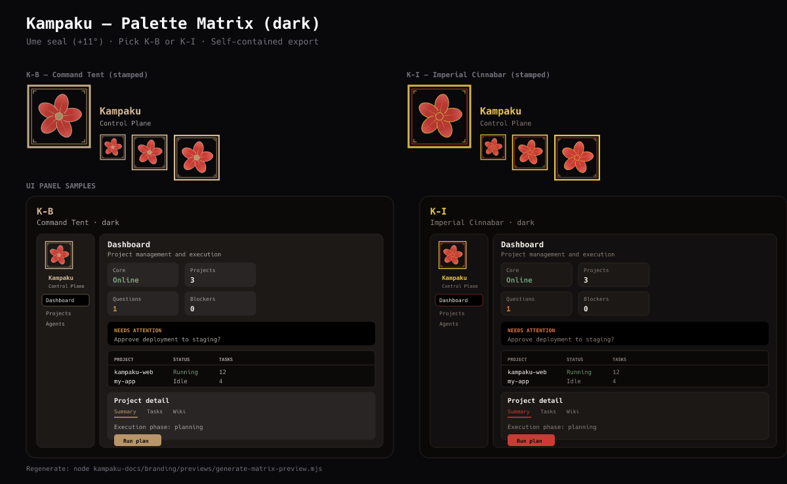

<p align="center">
  
</p>

<h1 align="center">Kampaku</h1>

<p align="center">
  <strong>The personal control plane for persistent AI agents.</strong><br />
  You set intent. Kampaku plans, delegates, executes, and reports — without losing the thread when the chat closes.
</p>

<p align="center">
  <a href="https://github.com/kampaku-ai/kampaku/actions/workflows/ci.yml"></a>
  <a href="https://github.com/kampaku-ai/kampaku/actions/workflows/contracts.yml"></a>
  <a href="https://github.com/kampaku-ai/kampaku/actions/workflows/security.yml"></a>
  <a href="LICENSE"></a>
  <br />
  
  
  
  
  
</p>

<p align="center">
  <a href="#what-is-kampaku">What</a> ·
  <a href="#why-it-exists">Why</a> ·
  <a href="#how-it-works">How</a> ·
  <a href="#architecture">Architecture</a> ·
  <a href="#quick-start">Start</a> ·
  <a href="#stack">Stack</a> ·
  <a href="#documentation">Docs</a> ·
  <a href="#contributing">Contribute</a>
</p>

---

## What is Kampaku

Kampaku is **not another chat UI**. It is an open-source **orchestration layer** for a standing team of AI agents that:

1. Accept high-level intent from a human (the *emperor*)
2. Decompose work into durable **projects** and **work items**
3. Route responsibility through an **agent hierarchy** with skills and least privilege
4. Lease execution to **sandboxed workers** that change real repositories
5. Surface questions, blockers, journals, and wiki truth on **chat, CLI, and web**

Private project repos stay external. This monorepo is the **platform** — control plane, workers, operator UI, and contracts.

<p align="center">
  
</p>

<p align="center"><em>Imperial Cinnabar brand system — calm command aesthetic, not a toy dashboard.</em></p>

## Why it exists

Most agent demos collapse when you close the tab. Kampaku is built for work that must **survive overnight**:

| Promise | What you get |
|---------|--------------|
| **Intent over micromanagement** | State the outcome; the hierarchy plans and delegates |
| **Durable by default** | Work items, job leases, journals, and wiki outlive process crashes and model swaps |
| **Three surfaces, one truth** | Chat, CLI, and web show the same IDs and fields after every mutation |
| **Bounded autonomy** | Sandboxed workers, path policy, human gates when decisions are missing |
| **Honest done** | Completion needs evidence — tests, checks, and inspectable artifacts — not a green board on an empty repo |
| **Provider portable** | Stub mode for CI; FreeLLMAPI (or any OpenAI-compatible router) for real models |

> The person defines intent and priorities. Kampaku manages execution while preserving visibility and control.

## How it works

```text
  You (intent) ──► Kampaku advisor ──► Project lead / specialists
                                              │
                                              ▼
                                       Work item tree
                                              │
                                              ▼
                                   Worker leases a job
                                              │
                                              ▼
                              Sandbox + coding tools on a repo
                                              │
                                              ▼
                         Result · journal · wiki · questions / blockers
                                              │
                                              ▼
                              Chat · CLI · Web (same truth)
```

1. **Clarify** — Kampaku triages intent; asks when a decision is missing  
2. **Staff & plan** — project leads own coherence; specialists own decomposition  
3. **Execute** — workers lease jobs, mutate allowed folders, run required checks  
4. **Govern** — escalate questions/blockers; pause, redirect, or cancel from any surface  
5. **Remember** — private agent memory, superior journals, and verified wiki stay distinct  

## Architecture

```text
  Operator (Web · CLI · Chat)
              │
         Core API (Hono)
              │
     ┌────────┴────────┐
     │                 │
 Model Broker     BaseStore (SQLite)
     │                 │
     └────────┬────────┘
              │
        Worker API
              │
   Job runner · executors · sandbox · coding tools
```

| Plane | Package | Responsibility |
|-------|---------|----------------|
| **Control** | [`apps/core`](apps/core) | Durable state, agent runtime, planner, delegator, CLI |
| **Execution** | [`apps/worker`](apps/worker) | Job lease loop, sandbox, FreeLLM/echo/github executors |
| **Interface** | [`apps/web`](apps/web) | Next.js operator UI — dashboard, chat, panels, settings |
| **Contracts** | [`packages/contracts`](packages/contracts) | OpenAPI, JSON Schemas, skill catalog, tool specs |

Runtime authorization is enforced in code (actor, project, parent work item, skill). Prompts are not a grant.

## Quick start

**Requirements:** [Node.js 22+](https://nodejs.org/) and npm.

```bash
git clone https://github.com/kampaku-ai/kampaku.git
cd kampaku
npm install
cp .env.example .env
```

Verify the monorepo:

```bash
npm run typecheck
npm test
npm run build
```

Start the full stack (Core + Worker + Web; **stubs by default**):

```bash
./scripts/kampaku dev
```

| Surface | URL |
|---------|-----|
| Web UI | http://127.0.0.1:3002 |
| Core API | http://127.0.0.1:8080 |
| FreeLLMAPI (optional) | http://127.0.0.1:3001 |

Point `.env` at FreeLLMAPI when you want real model-backed planning and execution. Leave stubs for offline and CI.

### Useful scripts

| Command | Purpose |
|---------|---------|
| `npm run typecheck` | TypeScript across worker + core |
| `npm test` | Unit tests (worker, web, core) |
| `npm run build` | Build all apps |
| `npm run lint` | Web lint |
| `npm run contracts:check` | Validate shared contracts |
| `npm run test:e2e` | Playwright operator smoke |
| `npm run smoke` | End-to-end job loop smoke |

## Stack

| Layer | Choice |
|-------|--------|
| Language | TypeScript on Node.js 22+ |
| Monorepo | npm workspaces (`apps/*`, `packages/*`) |
| Control API | [Hono](https://hono.dev/) + `@hono/node-server` |
| Persistence | SQLite via [Drizzle ORM](https://orm.drizzle.team/) |
| Operator UI | [Next.js](https://nextjs.org/) App Router |
| Validation | Zod + `packages/contracts` |
| Models | OpenAI-compatible client → FreeLLMAPI (or stubs) |

## Repository layout

```text
kampaku/
├── apps/
│   ├── core/           # Control plane + `kampaku` CLI
│   ├── worker/         # Execution plane
│   └── web/            # Operator UI
├── packages/
│   └── contracts/      # Schemas, OpenAPI, skills, tool specs
├── docs/               # Architecture, product, security, branding, evals
├── scripts/            # install / start / stop / smoke
└── .github/workflows/  # CI, contracts, security, release
```

## Documentation

| Topic | Link |
|-------|------|
| Documentation hub | [`docs/README.md`](docs/README.md) |
| Architecture overview | [`docs/architecture/overview.md`](docs/architecture/overview.md) |
| Agent hierarchy | [`docs/architecture/agent-hierarchy.md`](docs/architecture/agent-hierarchy.md) |
| Security model | [`docs/security/security-model.md`](docs/security/security-model.md) |
| Product vision | [`docs/product/vision.md`](docs/product/vision.md) |
| Brand foundations | [`docs/branding/foundations.md`](docs/branding/foundations.md) |
| UI guidelines | [`docs/design/ui-guidelines.md`](docs/design/ui-guidelines.md) |
| Product eval suites (01–19) | [`docs/eval/README.md`](docs/eval/README.md) |
| Contributing | [`CONTRIBUTING.md`](CONTRIBUTING.md) |
| Security policy | [`SECURITY.md`](SECURITY.md) |

The [`docs/eval`](docs/eval) lab scores Kampaku against an **emperor-grade product bar** — not against its own internal skill catalog. Suite protocols live in `docs/eval/`; run board and learnings live in [`docs/eval/results/`](docs/eval/results/).

## Contributing

1. Branch from `develop` as `feature/<short-description>`
2. Keep UI copy, docs, tests, and commits in **English**
3. Put cross-process shapes in `packages/contracts` before consumers
4. Prefer extending an existing eval suite when emperor-visible behavior changes
5. Open a PR into `develop`; promote to `main` only after release checks

Branching details: [`docs/development/branching-strategy.md`](docs/development/branching-strategy.md).  
Operating model: [`.cursor/rules/agent-operating-model.mdc`](.cursor/rules/agent-operating-model.mdc).

## Status

Kampaku is under active development (`v0.1.0`). The vertical slice — intent → work items → leased jobs → sandboxed execution → inspectable results — is in place. Provider fidelity, operator journeys, and the full eval arc continue to harden.

## License

Released under the [MIT License](LICENSE).  
Copyright © 2026 Kampaku contributors.

---

<p align="center">
  
  <br />
  <sub>Calm command. Durable work. Visible authority.</sub>
</p>
