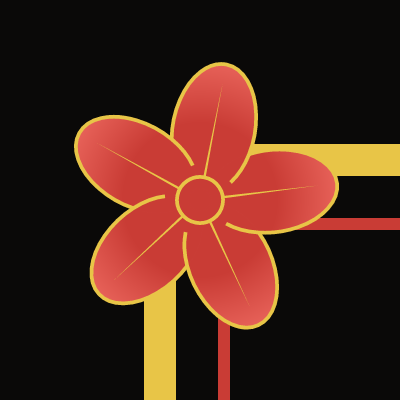

<p align="center">
  
</p>

<h1 align="center">Kampaku</h1>

<p align="center">
  <strong>The personal software factory.</strong><br />
  You open a work order. Kampaku plans it, staffs a line, builds it, verifies it against the project's own toolchain, and ships it — without losing the thread when the chat closes.
</p>

<p align="center">
  <a href="https://github.com/kampaku-ai/kampaku/actions/workflows/ci.yml"></a>
  <a href="https://github.com/kampaku-ai/kampaku/actions/workflows/contracts.yml"></a>
  <a href="https://github.com/kampaku-ai/kampaku/actions/workflows/security.yml"></a>
  <a href="LICENSE"></a>
  <br />
  
  
  
  
  
</p>

<p align="center">
  <a href="#what-is-kampaku">What</a> ·
  <a href="#what-it-ships">Ships</a> ·
  <a href="#the-line">The line</a> ·
  <a href="#invariants">Invariants</a> ·
  <a href="#architecture">Architecture</a> ·
  <a href="#quick-start">Start</a> ·
  <a href="#documentation">Docs</a> ·
  <a href="#contributing">Contribute</a>
</p>

---

## What is Kampaku

Kampaku is **not another chat UI** and **not a coding assistant**. It is an open-source **software
factory**: a production line between one person's intent and shipped software.

1. You open a **work order** — a request in your own words
2. Kampaku reads the project, asks only genuinely blocking decisions, and **plans** verifiable slices
3. It **staffs** a lead and the specialists the stack actually needs
4. **Workers** lease jobs and produce artifacts inside the project's own repository, and nowhere else
5. **Inspection** re-executes the stated checks against the artifact; claims the durable state does
   not support are reported as unverified
6. **Shipment** is an artifact a stranger can build or run from its own docs, plus knowledge that
   matches disk

Project repositories stay external. This monorepo is the **platform** — control plane, workers,
operator UI, and contracts.

<p align="center"><em>Imperial Cinnabar brand system — calm command aesthetic, not a toy dashboard.</em></p>

## What it ships

Software and the technical artifacts software cannot exist without: applications, services,
libraries, SDKs, infrastructure as code, data and pipeline code, tooling, test assets, and the
technical documentation that ships with them.

**Out of scope by decision:** creative writing, open-ended research, non-technical documents, and
standalone design work. The product refuses these plainly rather than producing an unverifiable
artifact — see the [statute](docs/product/software-factory.md) and
[ADR-0004](docs/adr/0004-software-factory-charter.md).

## The line

```text
  Work order                    You: intent, priorities, decisions
      │
      ▼
  Front desk ──► Planning ──► Stations ──► Line ──► Inspection ──► Shipping
   intake          slices       staffing    jobs       evidence       artifact
      │
      ▼
  Shipped software · journal · wiki · questions / blockers · honest absence report
```

| Station | What it owns | Runtime |
|---------|--------------|---------|
| **Front desk** | Accept the order, classify it, create the container, ask blocking questions | Root agent, project record, questions |
| **Planning** | Read the repository, choose acceptance evidence, slice vertically | Project lead, work-item tree, plan preview |
| **Stations** | Bounded responsibilities with least privilege | Agent hierarchy, skills |
| **Line** | Produce artifacts in the project's repository | Worker lease loop, sandbox, executors, tools |
| **Inspection** | Re-execute checks, reconcile claims, reopen on failure | Evidence records, quality gates, claim audit |
| **Shipping** | Versioned artifact plus knowledge that matches disk | Completion reports, wiki, repository state |

## Why it exists

Most agent demos collapse when you close the tab, and most of them cannot tell a finished artifact
from a confident paragraph. Kampaku is built for work that must **survive overnight** and be
**verifiable in the morning**:

| Promise | What you get |
|---------|--------------|
| **Work order over micromanagement** | State the outcome; the line plans and delegates |
| **Durable by default** | Work items, job leases, journals, and wiki outlive process crashes and model swaps |
| **Three surfaces, one truth** | Chat, CLI, and web show the same ids and fields after every mutation |
| **Bounded autonomy** | Sandboxed workers, path policy, least privilege, durable human gates |
| **Honest done** | Completion needs evidence re-executed against the artifact — not a green board on an empty repo |
| **Unverified claims surfaced** | A reply is reconciled against durable state; a claim the state does not support is reported |
| **Portable** | Any OpenAI-compatible model endpoint; any worker host that implements the contract |

> The person defines intent and priorities. Kampaku manages execution while preserving visibility and control.

## Invariants

The factory knows the deliverable is software. It assumes nothing else about the work:

| Invariant | Meaning | Eval |
|-----------|---------|------|
| **Language-agnostic** | Any language, any toolchain, polyglot repositories included | [18](docs/eval/18-language-agnostic.md) |
| **Project-type-agnostic** | Greenfield, brownfield, legacy, maintenance, migration, hardening | [19](docs/eval/19-brownfield-and-legacy.md), [21](docs/eval/21-maintenance-and-bugfix.md) |
| **Architecture-agnostic** | Single package, monorepo, multi-repo, microservices, embedded | [20](docs/eval/20-multi-repo-and-services.md) |

Read the project, then act inside it. Never reshape it to suit the factory. Details:
[agnosticism invariants](docs/concepts/agnosticism-invariants.md).

## Architecture

```text
  Operator (Web · CLI · Chat)
              │
         Core API (Hono)
              │
     ┌────────┴────────┐
     │                 │
 Model Broker     BaseStore (SQLite)
     │                 │
     └────────┬────────┘
              │
        Worker API
              │
   Job runner · executors · sandbox · coding tools
```

| Plane | Package | Responsibility |
|-------|---------|----------------|
| **Control** | [`apps/core`](apps/core) | Durable state, agent runtime, planner, delegator, CLI |
| **Execution** | [`apps/worker`](apps/worker) | Job lease loop, sandbox, model/echo/github executors |
| **Interface** | [`apps/web`](apps/web) | Next.js operator UI — dashboard, chat, panels, settings |
| **Contracts** | [`packages/contracts`](packages/contracts) | OpenAPI, JSON Schemas, skill catalog, tool specs |

Runtime authorization is enforced in code (actor, project, parent work item, skill). Prompts are
not a grant. Overview: [docs/architecture/overview.md](docs/architecture/overview.md).

## Quick start

**Requirements:** [Node.js 22+](https://nodejs.org/) and npm.

```bash
git clone https://github.com/kampaku-ai/kampaku.git
cd kampaku
npm install
cp .env.example .env
```

Verify the monorepo:

```bash
npm run typecheck
npm test
npm run build
```

Create the project registry — the default **Kampaku** project, the front-office agent and the folder
projects live in:

```bash
./scripts/kampaku bootstrap
```

Start the full stack (Core + Worker + Web; **stubs by default**):

```bash
./scripts/kampaku dev
```

`bootstrap` is a step of its own, deliberately: no chat turn can be driven until a project exists,
`kampaku chat` refuses one with *"No project found. Run `kampaku bootstrap` first."*, and starting the
stack does **not** create a project for you — `dev` reports that it is missing and names the command
rather than writing a container behind you.

| Surface | URL |
|---------|-----|
| Web UI | http://127.0.0.1:28002 |
| Core API | http://127.0.0.1:28080 |

The ports are declared once, in [`scripts/ports.env`](scripts/ports.env), and read by the scripts and by
both apps. They are deliberately not 3000/8080: see
[`docs/development/local-ports.md`](docs/development/local-ports.md) for why, and
`./scripts/ports.sh check` to see whether they are free.

Point `.env` at a model endpoint when you want real model-backed planning and execution:

```bash
KAMPAKU_MODEL_BASE_URL=https://your-endpoint.example/v1
KAMPAKU_MODEL_API_KEY=...
```

Any OpenAI-compatible endpoint works; there is no provider default. Leave stubs for offline and CI.

### Where a project may live

The factory reads and writes only inside the folders it has been allowed, and `bootstrap` allows the
home directory, the workspace, and the projects folder. A project checkout **outside** them — `/tmp/…`,
`/srv/…`, a second disk — is refused before anything is stored, because a repository link nobody can
read is a claim the product cannot keep.

```bash
node apps/core/dist/cli.js settings folders add /srv/checkouts --label checkouts
node apps/core/dist/cli.js settings folders list
```

Grant the folder your project lives in, then open the work order. The refusal names the folders in
force, so an operator who hits it is told what to do rather than left guessing.

#### The folder the factory works in

```bash
KAMPAKU_PROJECTS_DIR=~/kampaku-projects   # the default
```

Project checkouts belong in this folder, one directory per project, named by the project's slug. The agents
are told the path, so a new project is proposed as `<KAMPAKU_PROJECTS_DIR>/<slug>` rather than as an
improvised absolute path somewhere in the operator's home folder — which is how a machine ends up with one
directory per project mixed in with everything else its owner keeps there.

It is **created by `kampaku bootstrap` and `kampaku serve`**, and granted as an allowed folder at bootstrap.
Nothing else creates it: the default points at the operator's home, so a runtime that made the directory on
whichever call loaded a config would let any test suite or embedded caller write there.

Two things it does **not** do, because both are refusals the product already makes and this setting is not
an escape hatch for them:

- it does not make `create_project` accept a repository path that does not exist — a checkout is still named,
  and made, before it is linked (`mkdir -p` is the operator's step, and the agents say so rather than
  promising to do it);
- it is not `KAMPAKU_WORKSPACE`, which is the platform checkout. That one is the **isolation boundary**: a
  project repository inside it is refused, and `bootstrap` reads the skill catalog from it. Nothing the
  factory creates for a project belongs inside it.

This setting is separate from `KAMPAKU_WORKSPACE` for exactly that reason. Before it existed, "where the
work lives" was not a setting at all — it was wherever a model typed a path.

> **Documentation honesty note.** The target configuration contract is the generic
> `KAMPAKU_MODEL_*` pair above. The current runtime still accepts legacy vendor-prefixed aliases and
> a default local endpoint; removing them, together with the vendor names in scripts, error messages,
> and templates, is the [multi-provider routing roadmap](docs/roadmap/11-multi-provider-routing.md). Until that
> phase lands, the legacy names still work and are not required.

### Useful scripts

| Command | Purpose |
|---------|---------|
| `npm run typecheck` | TypeScript across worker + core |
| `npm test` | Unit tests (worker, web, core) |
| `npm run build` | Build all apps |
| `npm run lint` | Web lint |
| `npm run contracts:check` | Validate shared contracts |
| `npm run test:e2e` | Playwright operator smoke |
| `npm run smoke` | End-to-end job loop smoke |

## Stack

| Layer | Choice |
|-------|--------|
| Language | TypeScript on Node.js 22+ (the platform's language — **not** a limit on the projects it builds) |
| Monorepo | npm workspaces (`apps/*`, `packages/*`) |
| Control API | [Hono](https://hono.dev/) + `@hono/node-server` |
| Persistence | SQLite via [Drizzle ORM](https://orm.drizzle.team/) |
| Operator UI | [Next.js](https://nextjs.org/) App Router |
| Validation | Zod + `packages/contracts` |
| Models | OpenAI-compatible client → any configured endpoint (or stubs) |

## Repository layout

```text
kampaku/
├── apps/
│   ├── core/           # Control plane + `kampaku` CLI
│   ├── worker/         # Execution plane
│   └── web/            # Operator UI
├── packages/
│   └── contracts/      # Schemas, OpenAPI, skills, tool specs
├── docs/               # Product, architecture, security, branding, evals
├── scripts/            # install / start / stop / smoke
└── .github/workflows/  # CI, contracts, security, release
```

## Documentation

| Topic | Link |
|-------|------|
| Documentation hub | [`docs/README.md`](docs/README.md) |
| **Product statute** — what it ships and refuses | [`docs/product/software-factory.md`](docs/product/software-factory.md) |
| **Agnosticism invariants** | [`docs/concepts/agnosticism-invariants.md`](docs/concepts/agnosticism-invariants.md) |
| Architecture overview | [`docs/architecture/overview.md`](docs/architecture/overview.md) |
| Agent hierarchy | [`docs/architecture/agent-hierarchy.md`](docs/architecture/agent-hierarchy.md) |
| Security model | [`docs/security/security-model.md`](docs/security/security-model.md) |
| Roadmap | [`docs/roadmap/`](docs/roadmap/) |
| Brand foundations | [`docs/branding/foundations.md`](docs/branding/foundations.md) |
| UI guidelines | [`docs/design/ui-guidelines.md`](docs/design/ui-guidelines.md) |
| Product eval lab (00–25) | [`docs/eval/README.md`](docs/eval/README.md) |
| Contributing | [`CONTRIBUTING.md`](CONTRIBUTING.md) |
| Security policy | [`SECURITY.md`](SECURITY.md) |

The [`docs/eval`](docs/eval) lab scores Kampaku against a **factory bar** — the deliverable, the
invariants, and the production properties — not against its own internal skill catalog. Suite
protocols live in `docs/eval/`; run board and learnings live in
[`docs/eval/results/`](docs/eval/results/).

## Contributing

1. Branch from `develop` as `feature/<short-description>`
2. Keep UI copy, docs, tests, and commits in **English**
3. Put cross-process shapes in `packages/contracts` before consumers
4. Prefer extending an existing eval suite when factory-visible behavior changes
5. Open a PR into `develop`; promote to `main` only after release checks

Branching details: [`docs/development/branching-strategy.md`](docs/development/branching-strategy.md).  
Operating model: [`.cursor/rules/agent-operating-model.mdc`](.cursor/rules/agent-operating-model.mdc).

## Status

Kampaku is under active development (`v0.1.0`). The vertical slice — work order → work items →
leased jobs → sandboxed execution → verified results — is in place, and the software-factory framing
is the product statute as of 2026-09-23.

Known and tracked: work-order intake is implemented and its blocking defect (F-001) is resolved.
The full P7 gate remains unscored pending fresh cross-surface evaluation; see the
[evaluation status](docs/eval/README.md) and [gap board](docs/eval/results/BOARD.md). Provider
neutrality is not finished, and stack-neutral evidence is not yet implemented. The
[roadmap](docs/roadmap/) sequences the remaining work.

## License

Released under the [MIT License](LICENSE).  
Copyright © 2026 Kampaku contributors.

---

<p align="center">
  
  <br />
  <sub>Calm command. Durable work. Visible authority.</sub>
</p>
